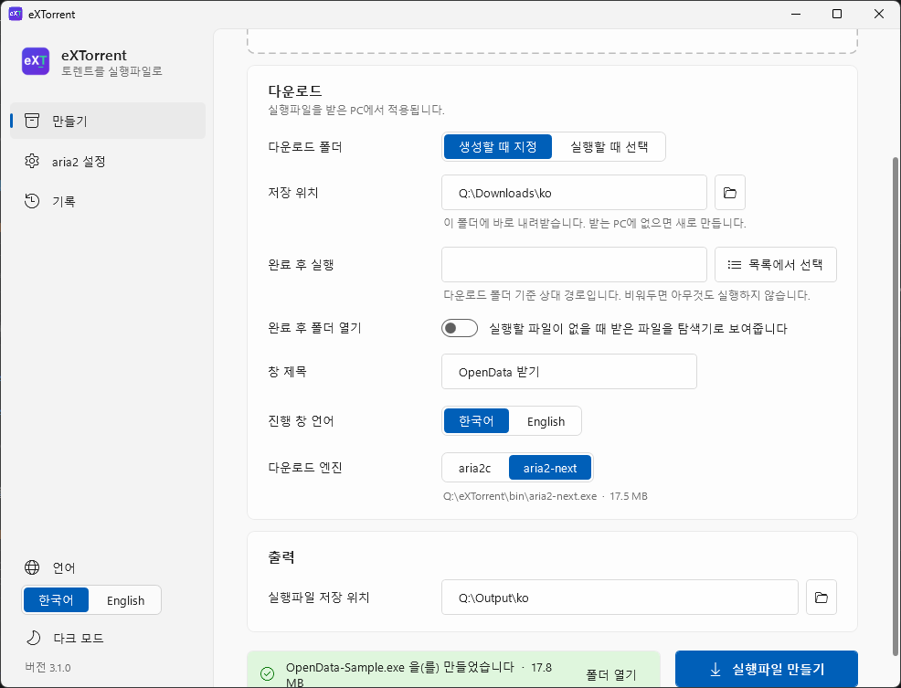
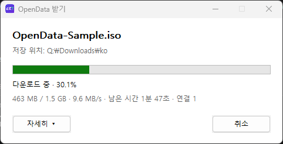

<p align="center">
  
</p>

<h1 align="center">eXTorrent</h1>

<p align="center">
  <b>.torrent 파일을 실행파일 하나로.</b><br>
  받는 사람은 토렌트 클라이언트 없이 더블클릭만으로 내려받습니다.
</p>

<p align="center">
  <a href="https://github.com/Zerojinny/eXTorrent/releases/latest"></a>
  
  <a href="LICENSE"></a>
</p>

<p align="center">
  한국어 · <a href="README.md">English</a>
</p>

---

<p align="center">
  <br><br>
  
</p>

## 무엇을 하나요

eXTorrent 빌더에 `.torrent` 파일을 넣으면 `<이름>.exe`가 만들어집니다.
이 실행파일을 받은 사람은 설치 없이 실행만 하면 됩니다. 실행하면 진행 창이 뜨고, 정해 둔 폴더로 토렌트를 내려받습니다.

- **설치 필요 없음**: 다운로드 엔진(aria2c 또는 aria2-next)이 실행파일 안에 들어 있습니다.
- **이어받기**: 중간에 취소하거나 창을 닫아도 다시 실행하면 받은 부분부터 이어서 받습니다.
- **완료 후 동작**: 받은 파일 중 하나를 실행하거나(예: 설치 프로그램), 받은 폴더를 탐색기로 엽니다.
- **회선 속도별 설정**: 받는 PC의 링크 속도가 1Gbps 이상인지에 따라 aria2 설정을 자동으로 고릅니다.
- **한국어 / English**: 빌더 화면과 진행 창 언어를 각각 고를 수 있고, `lang` 폴더에 파일을 추가해 언어를 늘릴 수 있습니다.
- **백신 오탐 최소화**: 배치 파일·PowerShell·관리자 권한·패커를 쓰지 않습니다. [자세히](#백신-오탐을-줄이기-위한-원칙)

## 시작하기

### 1. 내려받기

[Releases](https://github.com/Zerojinny/eXTorrent/releases/latest)에서 zip을 받아 원하는 폴더에 풉니다.

```
eXTorrent.exe          빌더
bin\launcher.exe       만든 실행파일의 바탕이 되는 런처
bin\aria2.conf.100     aria2 설정 (1Gbps 미만)
bin\aria2.conf.1G      aria2 설정 (1Gbps 이상)
lang\ko.ini, en.ini    언어 파일
```

**요구 사항**: Windows 10 / 11 (64비트), .NET Framework 4.8 (Windows 10 1903 이상과 Windows 11에는 기본으로 들어 있습니다)

### 2. 실행파일 만들기

1. `eXTorrent.exe`를 실행하고 `.torrent` 파일을 창에 끌어다 놓습니다. 파일을 `eXTorrent.exe` 아이콘에 끌어다 놓아도 됩니다.
2. 받는 PC에 적용할 설정을 정합니다.

   | 항목 | 설명 |
   |---|---|
   | 다운로드 폴더 | **생성할 때 지정**: 정한 폴더로 바로 받습니다. 환경 변수를 쓸 수 있습니다(예: `%USERPROFILE%\Downloads`).<br>**실행할 때 선택**: 실행하면 폴더 선택 창이 뜹니다. |
   | 완료 후 실행 | 토렌트에 들어 있는 파일 중 하나를 고르면 다 받은 뒤 실행합니다. |
   | 완료 후 폴더 열기 | 실행할 파일이 없을 때 받은 파일을 탐색기로 보여 줍니다. |
   | 창 제목 / 진행 창 언어 | 받는 사람이 보는 진행 창의 제목과 언어입니다. |
   | 다운로드 엔진 | `aria2c` 또는 `aria2-next`. [아래](#다운로드-엔진) 참고 |

3. **실행파일 만들기**를 누릅니다. 고른 엔진이 `bin`에 없으면 이때 GitHub에서 공식 바이너리를 내려받아 `bin`에 저장합니다.

**설정 저장**을 누르면 현재 설정이 `config.ini`에 저장되어 다음에도 그대로 쓰입니다.

### 3. 명령줄로 만들기

```
eXTorrent.exe "토렌트 파일" "실행파일 저장 폴더" [/q]
```

창 없이 바로 만듭니다. 다운로드 설정은 `config.ini`, aria2 설정은 `bin\aria2.conf.*`를 씁니다. 엔진이 없으면 내려받습니다.
`/q`를 붙이면 결과 메시지 창도 띄우지 않습니다. 종료 코드는 `0` 성공, `1` 실패입니다.

## 다운로드 엔진

| | aria2c | aria2-next |
|---|---|---|
| 프로젝트 | [aria2/aria2](https://github.com/aria2/aria2) | [AnInsomniacy/aria2-next](https://github.com/AnInsomniacy/aria2-next) |
| 특징 | 오래 쓰여 온 aria2 공식 빌드 | aria2와 같은 명령줄·설정을 쓰고, BitTorrent는 libtorrent-rasterbar 기반 |
| 실행파일 크기 증가 | 약 6MB | 약 18MB |
| 내려받을 때 확인 | 공식 릴리스 zip (HTTPS) | 공식 릴리스 exe + `checksums.sha256` 대조 |

- 두 엔진 모두 **다시 빌드하지 않은 공식 릴리스 바이너리**를 그대로 씁니다.
- 엔진 파일은 빌더의 `bin` 폴더에 `aria2c.exe`, `aria2-next.exe`로 저장됩니다. 새 버전을 쓰려면 지우고 다시 만들면 됩니다.
- 내려받기는 빌더에서만 합니다. 만든 실행파일은 실행할 때 인터넷에서 프로그램을 받지 않습니다.

## aria2 설정

빌더의 **aria2 설정** 페이지에서 `bin\aria2.conf.100`과 `bin\aria2.conf.1G`를 편집합니다.
받는 PC의 링크 속도(유선·무선 어댑터 중 가장 빠른 값)가 1Gbps 이상이면 `1G`, 아니면 `100` 설정을 씁니다.

기본 설정에서 알아 둘 점:

- `check-integrity=true`: 다시 실행했을 때 이미 받은 데이터를 검사하고 이어받습니다. 끄지 마세요.
- `seed-time=0`: 다 받으면 시드하지 않고 바로 끝납니다. 받는 동안에는 BitTorrent 특성상 업로드가 일어납니다(`max-upload-limit`로 제한).
- `enable-dht=true`, `enable-peer-exchange=true`: 트래커가 없거나 트래커가 응답하지 않아도 DHT와 피어 교환으로 피어를 찾습니다. 사설 트래커 토렌트만 쓴다면 `false`로 바꿔도 됩니다. `bt-enable-lpd`(같은 네트워크의 피어 찾기)는 꺼져 있습니다.

## 받는 PC에서 일어나는 일

1. 실행파일 끝에 붙은 데이터(토렌트, 설정, 엔진)를 읽고 CRC로 손상 여부를 확인합니다.
2. `%LOCALAPPDATA%\eXTorrent\`에 엔진을 꺼냅니다. 같은 엔진이 이미 있으면 다시 쓰지 않습니다.
3. 엔진을 창 없이 실행하고, 출력에서 진행률·속도·남은 시간을 읽어 진행 창에 보여 줍니다.
4. 취소하면 엔진에 Ctrl+C를 보내 이어받기 정보를 저장한 뒤 끝냅니다(15초 안에 끝나지 않으면 강제 종료).
5. 다 받으면 완료 후 실행 파일을 실행하거나 폴더를 엽니다.

실행파일 종료 코드: `0` 완료 · `1` 오류 · `2` 사용자가 취소

## 백신 오탐을 줄이기 위한 원칙

예전 AutoIt + 7-Zip SFX 방식은 백신 오탐이 잦았습니다. eXTorrent는 다음 원칙으로 다시 만들었습니다.

- 배치 파일, PowerShell, wmic, netsh(방화벽 변경), 관리자 권한 상승을 쓰지 않습니다. 필요한 일은 Win32 API로 직접 합니다.
- `%TEMP%`에 풀지 않고 `%LOCALAPPDATA%\eXTorrent`를 씁니다.
- UPX 같은 패커를 쓰지 않고, 덧붙이는 데이터도 압축하지 않습니다(고엔트로피 데이터는 패커로 의심받습니다).
- 버전 정보 리소스와 매니페스트(`asInvoker`)를 넣습니다.
- 받는 PC에서 프로그램을 내려받아 실행하지 않습니다.

그래도 서명되지 않은 실행파일이라 Windows SmartScreen 경고가 나올 수 있습니다. 런처 코드 서명은 남은 과제입니다.

## 직접 빌드하기

**필요한 것**

- Visual Studio 2022 이상(Build Tools도 가능)의 **C++ 데스크톱 개발** 도구와 **Windows SDK**
  - SDK가 없으면 `'rc' is not recognized`로 실패합니다. `winget install Microsoft.WindowsSDK.10.0.26100`
- C# 빌더는 Windows에 기본으로 들어 있는 `%WINDIR%\Microsoft.NET\Framework64\v4.0.30319\csc.exe`로 빌드합니다. .NET SDK는 필요 없습니다.

```
build.bat
```

결과물은 `bin\launcher.exe`(C, MSVC x64)와 `eXTorrent.exe`(C# 5 / WPF)입니다.

**소스 구조**

```
src/launcher/   런처 (C, Win32 API) — 받는 사람이 실행하는 부분
src/builder/    빌더 (C# 5, WPF) — XAML은 실행 시 XamlReader로 읽음
lang/           언어 파일 ([builder], [launcher] 섹션)
bin/            aria2 설정, 빌드한 launcher.exe, 내려받은 엔진
```

**실행파일 형식**

```
[launcher.exe]
[항목]* = [u16 이름 길이][이름 UTF-8][u32 데이터 길이][데이터]
[푸터]  = "EXTR" [u32 항목 시작 오프셋] [u32 항목 전체 크기] [u32 항목 CRC32]   (리틀 엔디언)
```

항목: `<이름>.torrent`, `aria2.conf.100`, `aria2.conf.1G`, `settings.ini`, `lang.ini`, `engine.exe`

## 언어 추가

`lang\en.ini`를 복사해 `lang\ja.ini`처럼 이름을 바꾸고 `[info] Name`과 값을 번역하면 빌더의 언어 선택에 자동으로 나타납니다.
값에서 `\n`은 줄바꿈, `{0}` `{1}`은 실행할 때 채워지는 자리 표시자입니다.

## 주의

eXTorrent는 배포 권한이 있는 파일(직접 만든 자료, 오픈 라이선스 콘텐츠 등)을 전달하기 위한 도구입니다. 저작권을 침해하는 콘텐츠를 배포하는 데 쓰지 마세요.

## 라이선스

eXTorrent는 [GNU General Public License v2.0 이상](LICENSE)으로 배포합니다.

만든 실행파일에는 다음 GPL 소프트웨어의 공식 바이너리가 들어갑니다. 만든 실행파일을 배포할 때는 GPL에 따라 아래 소스 위치를 함께 안내해 주세요.

- [aria2](https://github.com/aria2/aria2) — GPL-2.0-or-later, Copyright © Tatsuhiro Tsujikawa
- [aria2-next](https://github.com/AnInsomniacy/aria2-next) — GPL-2.0-or-later, Copyright © aria2-next contributors
