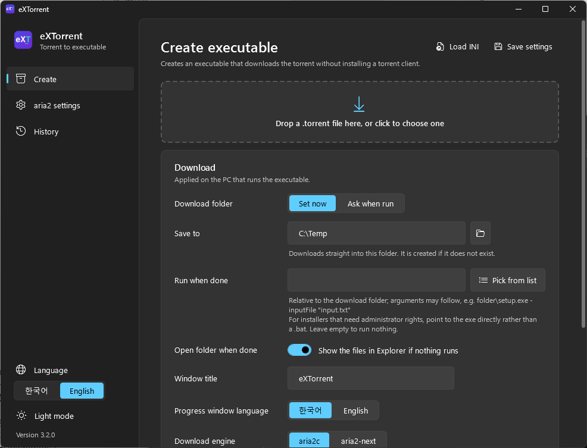
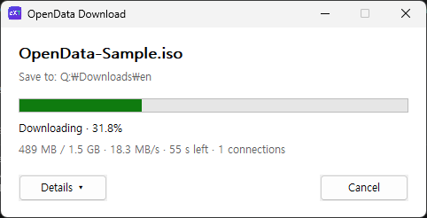

<p align="center">
  
</p>

<h1 align="center">eXTorrent</h1>

<p align="center">
  <b>Turn a .torrent file into a single executable.</b><br>
  Recipients download with a double-click — no torrent client needed.
</p>

<p align="center">
  <a href="https://github.com/Zerojinny/eXTorrent/releases/latest"></a>
  
  <a href="LICENSE"></a>
</p>

<p align="center">
  <a href="README.ko.md">한국어</a> · English
</p>

---

<p align="center">
  <br><br>
  
</p>

## What it does

Give the eXTorrent builder a `.torrent` file and it produces `<name>.exe`.
Whoever receives that executable just runs it: a progress window opens and the torrent is downloaded into the folder you chose. Nothing is installed.

- **No install**: the download engine (aria2c or aria2-next) is inside the executable.
- **Resume**: cancel or close the window at any time; running it again continues where it left off.
- **When done**: run one of the downloaded files (e.g. a setup program) or open the folder in Explorer.
- **Link-speed profiles**: picks one of two aria2 configurations depending on whether the recipient's link is 1 Gbps or faster.
- **Korean / English**: the builder UI and the progress window language are chosen separately; add more languages by dropping a file into `lang`.
- **Few antivirus false positives**: no batch files, PowerShell, elevation, or packers. [Details](#keeping-antivirus-false-positives-down)

## Getting started

### 1. Download

Get the zip from [Releases](https://github.com/Zerojinny/eXTorrent/releases/latest) and extract it anywhere.

```
eXTorrent.exe          builder
bin\launcher.exe       launcher that generated executables are built on
bin\aria2.conf.100     aria2 settings (below 1 Gbps)
bin\aria2.conf.1G      aria2 settings (1 Gbps and above)
lang\ko.ini, en.ini    language files
```

**Requirements**: Windows 10 / 11 (64-bit), .NET Framework 4.8 (built into Windows 10 1903+ and Windows 11)

### 2. Create an executable

1. Run `eXTorrent.exe` and drop a `.torrent` file onto the window (or onto the `eXTorrent.exe` icon).
2. Choose the settings that apply on the recipient's PC.

   | Setting | Description |
   |---|---|
   | Download folder | **Set now**: download straight into this folder. Environment variables work (e.g. `%USERPROFILE%\Downloads`).<br>**Ask when run**: a folder picker opens when the executable runs. |
   | Run when done | Pick a file from the torrent to run after the download completes. Arguments may follow (e.g. `R2024a\setup.exe -inputFile "installer_input.txt"`).<br>For installers that need administrator rights, point to the exe directly rather than a `.bat`, so that Windows shows the UAC prompt. A non-zero exit code is shown as a warning in the progress window. |
   | Open folder when done | Shows the downloaded files in Explorer if nothing is run. |
   | Window title / Progress window language | Title and language of the window the recipient sees. |
   | Download engine | `aria2c` or `aria2-next`. See [below](#download-engines). |

3. Click **Create executable**. If the selected engine is not in `bin` yet, the official binary is downloaded from GitHub and saved to `bin` at this point.

**Save settings** stores the current settings in `config.ini` for next time.

### 3. Command line

```
eXTorrent.exe "torrent file" "output folder" [/q]
```

Builds without opening a window, using `config.ini` for download settings and `bin\aria2.conf.*` for aria2 settings. A missing engine is downloaded.
`/q` also suppresses the result message box. Exit code `0` = success, `1` = failure.

## Download engines

| | aria2c | aria2-next |
|---|---|---|
| Project | [aria2/aria2](https://github.com/aria2/aria2) | [AnInsomniacy/aria2-next](https://github.com/AnInsomniacy/aria2-next) |
| Notes | The long-established official aria2 build | aria2's command line and config, BitTorrent on libtorrent-rasterbar |
| Added size | about 6 MB | about 18 MB |
| Verified on download | Official release zip (HTTPS) | Official release exe checked against `checksums.sha256` |

- Both engines are **unmodified official release binaries**.
- They are stored in the builder's `bin` folder as `aria2c.exe` and `aria2-next.exe`. Delete one to fetch the latest release on the next build.
- Only the builder downloads anything. Generated executables never fetch programs from the internet.

## aria2 settings

Edit `bin\aria2.conf.100` and `bin\aria2.conf.1G` on the builder's **aria2 settings** page.
If the fastest wired/wireless adapter on the recipient's PC links at 1 Gbps or more, `1G` is used; otherwise `100`.

About the defaults:

- `check-integrity=true`: on a rerun, existing data is verified and the download resumes. Keep it on.
- `seed-time=0`: the engine exits as soon as the download finishes, without seeding. Uploading still happens while downloading, as with any BitTorrent client (capped by `max-upload-limit`).
- `enable-dht=true`, `enable-peer-exchange=true`: peers are found through DHT and peer exchange even when there is no tracker or it does not respond. If you only use private-tracker torrents you may set them to `false`. `bt-enable-lpd` (local peer discovery) is off.

## What happens on the recipient's PC

1. The data appended to the executable (torrent, settings, engine) is read and checked with CRC32.
2. The engine is extracted to `%LOCALAPPDATA%\eXTorrent\` (reused if the same engine is already there).
3. The engine runs without a window; its output is parsed for progress, speed and time remaining.
4. On cancel, the engine receives Ctrl+C so it saves its resume data (it is terminated if it hasn't exited after 15 seconds).
5. When finished, the chosen file is run or the folder is opened.

Exit codes: `0` completed · `1` error · `2` cancelled by the user

## Keeping antivirus false positives down

The earlier AutoIt + 7-Zip SFX version was often flagged. eXTorrent was rebuilt around these rules:

- No batch files, PowerShell, wmic, netsh (firewall changes) or elevation. Everything is done with Win32 APIs.
- Files go to `%LOCALAPPDATA%\eXTorrent`, not `%TEMP%`.
- No packers such as UPX, and the appended data is not compressed (high-entropy appended data looks like a packer).
- Version information resource and manifest (`asInvoker`) are included.
- Nothing is downloaded and executed on the recipient's PC.

The executables are not code-signed yet, so Windows SmartScreen may still warn. Signing the launcher is on the to-do list.

## Building from source

**Requirements**

- Visual Studio 2022 or later (Build Tools are fine) with **Desktop development with C++** and a **Windows SDK**
  - Without the SDK the build fails with `'rc' is not recognized`: `winget install Microsoft.WindowsSDK.10.0.26100`
- The C# builder is compiled with the `csc.exe` that ships with Windows (`%WINDIR%\Microsoft.NET\Framework64\v4.0.30319`). No .NET SDK is needed.

```
build.bat
```

Outputs `bin\launcher.exe` (C, MSVC x64) and `eXTorrent.exe` (C# 5 / WPF).

**Source layout**

```
src/launcher/   launcher (C, Win32 API) — the part the recipient runs
src/builder/    builder (C# 5, WPF) — XAML is loaded at run time with XamlReader
lang/           language files ([builder] and [launcher] sections)
bin/            aria2 settings, built launcher.exe, downloaded engines
```

**Executable format**

```
[launcher.exe]
[entry]* = [u16 name length][name UTF-8][u32 data length][data]
[footer] = "EXTR" [u32 entries offset] [u32 entries size] [u32 entries CRC32]   (little-endian)
```

Entries: `<name>.torrent`, `aria2.conf.100`, `aria2.conf.1G`, `settings.ini`, `lang.ini`, `engine.exe`

## Adding a language

Copy `lang\en.ini` to e.g. `lang\ja.ini`, change `[info] Name` and translate the values; it appears in the builder's language selector automatically.
In values, `\n` is a line break and `{0}`, `{1}` are placeholders filled in at run time.

## Responsible use

eXTorrent is meant for distributing files you have the right to share (your own material, openly licensed content, and so on). Do not use it to distribute copyright-infringing content.

## License

eXTorrent is licensed under the [GNU General Public License v2.0 or later](LICENSE).

Generated executables contain official binaries of the following GPL software. When you distribute a generated executable, point recipients to these sources as the GPL requires.

- [aria2](https://github.com/aria2/aria2) — GPL-2.0-or-later, Copyright © Tatsuhiro Tsujikawa
- [aria2-next](https://github.com/AnInsomniacy/aria2-next) — GPL-2.0-or-later, Copyright © aria2-next contributors
